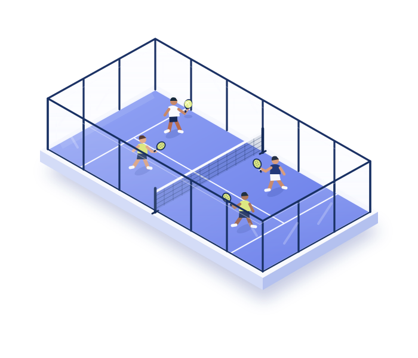

# Hi, I'm Subhi 👋

### Building [Courtat · كورتات](https://courtat.io)

**Your community. Better organisation.**  
**مجتمعك، بتنظيم أفضل.**

---

I'm building **Courtat**, an Arabic-first, bilingual workspace for people who run recurring sports communities — starting with padel.

Organizing a game means much more than booking a court. There's the changing WhatsApp list, player preferences, court arrangements, attendance, and the question of whether the session actually made money. I'm bringing that work into one place so hosts can spend more time with their community.

### What I'm working on

- **From WhatsApp to a session** — turn playing lists into structured rosters, with organizer review for unclear names.
- **Courts with context** — arrange players using levels, playing preferences, and pairing rules.
- **Financial clarity** — track player balances, receipts, expenses, and session results.
- **A better understanding of the community** — bring together attendance, player history, and useful session insights.
- **Arabic and English** — an organizer experience built for both languages, on desktop and mobile.

### Building the whole product

My work spans the organizer experience, court allocation logic, WhatsApp integration, financial records, and the infrastructure behind it. The focus is practical: make the next session easier to run, and give hosts a clearer picture of their community.

Courtat is actively being developed. This profile is a public introduction to the work; the application source is private.

### Follow the project

**[Visit Courtat.io →](https://courtat.io)**

If you organize padel sessions, I'd love to hear what takes the most effort each week.
