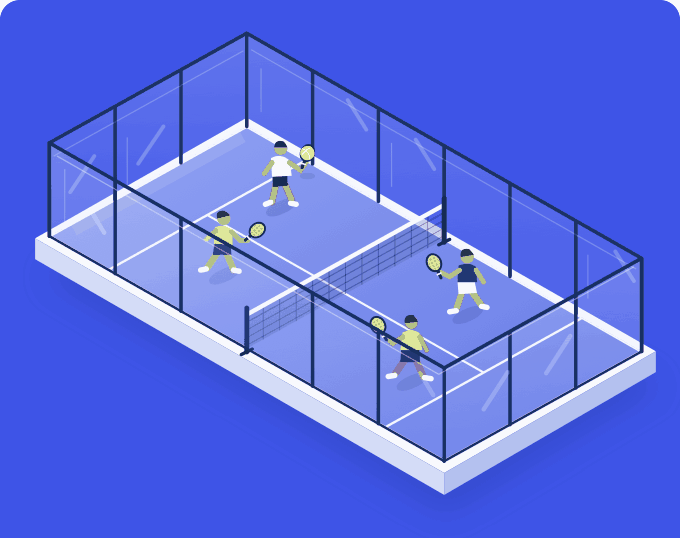

# Subhi · Building Courtat

### Your community. Better organisation.
**مجتمعك، بتنظيم أفضل.**

I'm building **[Courtat · كورتات](https://courtat.io)** — an Arabic-first, bilingual workspace  
for the people bringing padel communities together.

**[Explore Courtat.io ↗](https://courtat.io)**

*Less admin. More time for your community.*

---

### A game to organize. A community to run.

The WhatsApp list keeps changing. Players have preferences. Courts need arranging. Money needs reconciling. Courtat brings those moving parts into one organizer workspace.

| Before the session | On the court | Beyond the game |
| :--- | :--- | :--- |
| Turn WhatsApp lists into clear rosters. | Arrange players around levels, preferences, and pairing rules. | Understand balances, expenses, and session results. |
| Review names, waiting lists, and attendance. | Keep good pairs and refine the court board. | Learn from player history and community insights. |

### What I'm building

I'm working across the full product: the Arabic and English organizer experience, court allocation, WhatsApp integration, financial records, and the infrastructure that connects them.

The goal is simple: help hosts run the next session with less effort and a clearer picture of their community.

Courtat is actively being developed. The application source is private; this profile is where I introduce what I'm working on.

---

**Organize padel sessions? I'd love to hear what takes the most effort each week.**

[Meet Courtat →](https://courtat.io)

